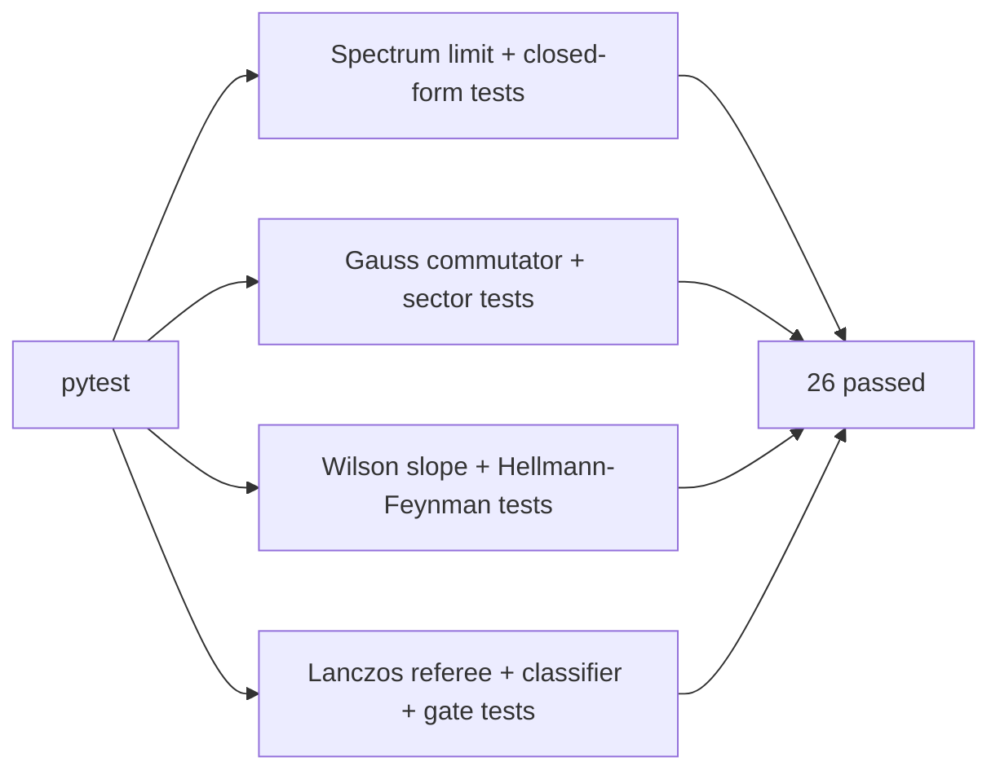
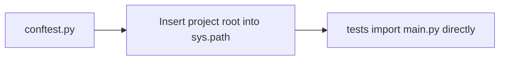
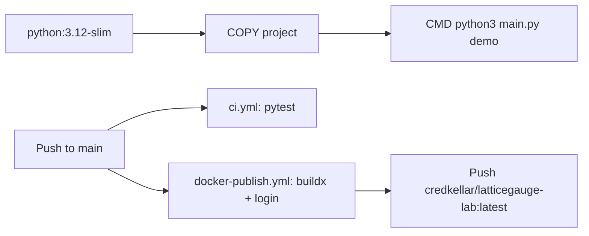

# LatticeGauge-Lab 🧲⚛️

**Z2 Lattice Gauge Theory Lab — Kogut–Susskind Hamiltonian, Gauss's Law, Wilson Loops & Static Charges** — by Darion Kellar

LatticeGauge-Lab is an **educational Z2 lattice gauge theory lab** in ONE pure-Python file. Links are qubits, the Hamiltonian is `H = −h Σ_links σˣ − J Σ_plaquettes Π σᶻ`, and every headline is computed on **two tiny lattices only** — a single plaquette (4 links, dimension 16) and a 2×1 ladder (7 links, dimension 128) — and graded two ways or against a closed form:

- the **spectrum view**: the plaquette's full spectrum from a from-scratch Jacobi eigensolver, matched exactly to both analytic limits — at J = 0 the levels `−h(4−2k)` with binomial degeneracies C(4,k), and at h = 0 the two levels **−J (×8) and +J (×8)**, because ONE plaquette operator has eigenvalues ±1 (see the deviation note in "What this does?" — the often-guessed `−J(4−2m)` form is **wrong** for a single plaquette, and this lab asserts the true spectrum);
- the **Gauss view**: vertex operators `G_v = Π σˣ` at each vertex, with `[H, G_v] = 0` to **0.00e+00** on both lattices, and the physical sector (all `G_v = +1`) counted two ways — direct X-basis enumeration and the formula `2^(L−V+1)` — agreeing at **2** (plaquette) and **4** (ladder);
- the **Wilson view**: for the single plaquette the Wilson loop IS the plaquette operator; its ground-state expectation runs from **0.000000** at J/h = 0 to **0.980581** at J/h = 20, with small-coupling slope **0.2500**, matching the first-order perturbation-theory coefficient **1/4** derived in the file, and the dual 't Hooft loop `⟨σˣ₀⟩` falling from 1 to 0.196116 over the same sweep;
- the **ladder view**: the 7-link ground energy at h = J = 1 is **−7.247399** by from-scratch Lanczos, refereed by an independent X-basis sector Jacobi problem (not a 128×128 diagonalisation), by both decoupled limits (−7h at J = 0, −2J at h = 0), and by the weak-coupling series `−7h − J²/(4h)`.

Honest scope, stated up front: **4–7 links, Z2 only, no continuum limit, no QCD claim of any kind.** The static-charge numbers (energy costs **1.883513 / 3.753440 / 4.643524** at separations 1 / 2 / 3 on the ladder) are a **tiny-lattice diagnostic, NOT a confinement proof** — those uses are permanent HOLD gates (14 total). 🔒

[](https://github.com/kimanicollier44-cmyk/LatticeGauge-Lab/actions/workflows/ci.yml)
[](https://github.com/kimanicollier44-cmyk/LatticeGauge-Lab/actions/workflows/docker-publish.yml)

> ℹ️ These are the **live** workflow badges for this repo. They activate as soon as the `ci.yml` and `docker-publish.yml` files from the paste pack are pasted into `.github/workflows/` — until then they have nothing to report yet.

## 🧰 Tech Stack Badges & Full Architecture Tech Stack

### 💻 Core Programming Languages & Core Systems


- 🐍 Python 3.12, pure standard library (`math`, `hashlib`, `json`, `sys`) — zero dependencies, zero network, deterministic (double-run byte-identical)
- 🧲 Gauge core from scratch: the Hamiltonian action written directly from the stated conventions (plaquette operators diagonal in the Z basis, `σˣ` flipping one link bit), a cyclic **Jacobi eigensolver** with eigenvectors that is refereed against known spectra before it is trusted, and a **Lanczos** ground-state solver with full reorthogonalisation and a splitmix64-seeded deterministic start
- ⚖️ Gauss core: commutators assembled column-by-column from operator actions (the exact dense commutator norm, no 128×128 products), sector bases enumerated in the X basis where `G_v` is diagonal, and sector Hamiltonians built in that basis as an independent referee
- 🎯 Wilson referee: the computed `⟨W⟩` is graded against both limits, against the derived first-order slope 1/4, and against Hellmann–Feynman (`dE₀/dJ = −⟨W⟩`, checked by central differences) — three independent gradings of one number
- 🧠 TinyML kNN regime classifier (from scratch, stdlib, distance-weighted): electric-dominated / crossover / magnetic-dominated from (J/h, ⟨W⟩, mean ⟨σˣ⟩), labels from the lab's own policy
- 🪑 Council seats: Gemini Argon 4 DECIDER (names-only, tighten-only) + Muse advisor (never overrides HOLD) + Google Flow plan-only (rendered = False, live = 0)

### ⛓️ Web3 & Infrastructure

- 🚫 **Not applicable — honestly.** No blockchain, no Web3, no tokens: the "infrastructure" in this lab is one offline file holding two tiny lattices. QCD, continuum, and production lattice claims are permanent HOLD gates, not features. No fake badges here.

### ⚙️ Platform Support & Hardware Architecture


- 🖥️ Pure Python — runs anywhere Python 3.12+ runs (Linux, macOS, Windows), plus the `python:3.12-slim` Docker image
- 🔒 No hardware is controlled, ever: real qubits, links, and laboratory hardware are permanent HOLD gates (see the gate table below)

### ⚡ Low-Level Infrastructure & Performance

- 🚫 **No low-level code — honestly.** No C, no C++, no GPU, no compiled extensions: this is one interpreted Python file on purpose, so every matrix entry can be read, checked, and diffed. Performance here means honest algorithms — a Jacobi eigensolver instead of a library call, Lanczos with full reorthogonalisation instead of a 128×128 dense diagonalisation, exact sector enumeration instead of sampling — all deterministic and byte-identical between runs.

### 🛠️ DevOps & Build Tools


- 🐳 Docker (`python:3.12-slim`), GitHub Actions CI + Docker Publish (delivered in the paste pack)
- 🎯 Target image: `credkellar/latticegauge-lab:latest`
- 🧪 Tests: `pytest` (26 tests) + the built-in CHECKS suite (53 checks) in `main.py`

### ☁️ Cloud Providers

- 🚫 **None — honestly.** No cloud provider is used or needed: the lab runs fully offline on your own machine or in a local Docker container. Docker Hub appears only as the registry the publish workflow pushes the image to.

## What this does?

1. 🧲 **Hamiltonian, conventions stated** — `H = −h Σ σˣ_l − J Σ_p Π σᶻ` with links as qubits: in the Z basis each plaquette operator is diagonal with eigenvalue `(−1)^(plaquette bit parity)` and each `σˣ_l` flips one bit, so the Hamiltonian action is written out exactly, with no hidden library call. The plaquette Hamiltonian is asserted symmetric and its spectrum obeys `Tr H = 0` and `Tr H² = dim·(L·h² + N_p·J²)`.
2. 🎛️ **Single plaquette, full spectrum** — all 16 eigenvalues by the refereed Jacobi solver. At h = J = 1 the ground energy is **−4.123106**, matching the closed form `−√(16h² + J²)` (asserted across a J grid), and the excited levels fall out at −√5 (×4), −1 (×3), +1 (×3), +√5 (×4), +√17.
3. ⚠️ **Deviation flagged, true spectrum asserted** — at J = 0 the spectrum is `−h(4−2k)` with degeneracies C(4,k) = 1, 4, 6, 4, 1, exactly as combinatorics demands. At h = 0 a plausible-looking guess is `−J(4−2m)`, but that is **wrong** for one plaquette: the single plaquette operator has eigenvalues ±1 only, so the computed (and asserted) spectrum is **−J with degeneracy 8 and +J with degeneracy 8**. The lab asserts the true behaviour, never a tuned one.
4. ⚖️ **Gauss's law, exactly** — `G_v = Π σˣ` over the links at vertex v commutes with H because every plaquette meets every vertex in 0 or 2 links (two anticommutations cancel). The commutator max deviation is **0.00e+00** on the plaquette and on the ladder, and both computed ground states satisfy `⟨G_v⟩ = +1` at every vertex.
5. 🔢 **Physical sector, counted two ways** — direct enumeration of X-basis labels with even parity at every vertex gives **2** states (plaquette) and **4** states (ladder); the formula `2^(L−V+1)` gives the same, the `+1` being the one redundancy `Π_v G_v = I`. All 32 ladder sectors are enumerated and partition the 128 states exactly.
6. 🪜 **Ladder ground state, honestly refereed** — Lanczos in the full 128-dimensional space gives **E₀ = −7.247399** at h = J = 1. The referee is stated plainly: an independent 4×4 Jacobi problem for H restricted to the physical sector in the X basis (agreement < 1e-8), **not** a full 128×128 Jacobi diagonalisation — plus both decoupled limits exactly (−7.000000 at J = 0, −2.000000 at h = 0) and the weak-coupling series `−7h − J²/(4h)` (−7.002500 predicted and computed at J = 0.1).
7. ➰ **Wilson loop across the sweep** — `⟨W⟩` in the plaquette ground state: 0.000000 (J/h = 0), 0.012499 (0.05), 0.024992 (0.1), 0.062378 (0.25), 0.124035 (0.5), **0.242536 (1)**, 0.447214 (2), 0.707107 (4), 0.928477 (10), 0.980581 (20) — monotone, → 0 in the electric limit and → 1 in the magnetic limit, and graded by Hellmann–Feynman against the ground energy's J-derivative.
8. 📐 **Perturbation theory, derived not quoted** — P flips all four X bits, landing on the state at excitation energy 8h, so the perturbed ground state carries amplitude J/(8h) of it and `⟨W⟩ = (1/4)(J/h) + …`. The computed slope at J/h = 0.05 is **0.2500**, asserted within 0.005 of the derived 1/4. The dual 't Hooft diagnostic `⟨σˣ₀⟩` does the opposite trip: 1.000000 → 0.196116.
9. 🔌 **Static charges — diagnostic, fenced** — flipping the Gauss sector at two ladder vertices (a charge pair) and re-solving the sector ground problem costs **1.883513** at separation 1, **3.753440** at separation 2, and **4.643524** at separation 3 (h = J = 1). The costs rise with separation **on this 7-link ladder**; the lab states in the same breath that 7 links cannot distinguish a linear rise from a saturating one — this is a diagnostic, **not a confinement proof**, and the charged-sector energies are themselves refereed two ways (X-basis Jacobi vs sector-restricted Lanczos in the Z representation).
10. 🏷️ **Regime classifier + seats + checks** — a from-scratch distance-weighted kNN labels ground states electric-dominated / crossover / magnetic-dominated from (J/h, ⟨W⟩, mean ⟨σˣ⟩) with labels from the lab's own policy (kNN == policy asserted on every scenario and all 250 grid rows), alongside Gemini Argon 4 DECIDER (sha256 trace, tighten-only), Muse advisor, Google Flow plan-only, 14 permanent HOLD gates, and a built-in CHECKS suite (53 checks) that re-derives every headline number above.

## 🗺️ How it works — diagram per script

### `main.py` — the whole lab

```mermaid
flowchart TD
    A[CLI: demo / checks / spectrum / gauss / wilson / ladder] --> B[Hamiltonian Action: Z-basis plaquettes + X flips]
    B --> C[Jacobi Eigensolver: refereed on known spectra]
    C --> D[Plaquette Spectrum: both analytic limits]
    B --> E[Gauss Operators: commutators = 0]
    E --> F[Sector Enumeration: 2^(L-V+1) two ways]
    B --> G[Lanczos: ladder ground state]
    F --> H[Sector Jacobi: independent referee]
    H --> G
    C --> I[Wilson Loop Sweep: slope 1/4 + Hellmann-Feynman]
    F --> J[Static Charges: sector energy costs]
    I --> K[kNN Regime Classifier]
    K --> L[Argon 4 DECIDER + Claude Advisor]
    L --> M{HOLD Gates x14}
    M -->|QCD / continuum / confinement-proof claims| N[HOLD - exit 2]
    M -->|sandbox sim| O[CHECKS + VERDICT PROCEED]
```

### `tests/test_main.py` — verification



### `conftest.py` — test path setup



### `Dockerfile` + CI flow — container & publish



## Why is this cool?

1. ⚖️ Gauss's law is **checked, not assumed**: the commutator is exactly zero in floating point (0.00e+00), because the 0-or-2-links geometry makes the anticommutations cancel — and the lab assembles that norm from operator actions so the 128-dimensional case is checked as honestly as the 16-dimensional one.
2. 🔢 The physical sector is **counted twice**: brute-force parity enumeration over every X-basis label and the `2^(L−V+1)` formula have to agree — and the `+1` in the exponent is explained by the one redundancy `Π_v G_v = I`, then verified by partitioning all 128 ladder states into 32 sectors.
3. 📐 The Wilson slope **1/4 is derived in the open**: one line of first-order perturbation theory (flip four X bits, pay 8h, amplitude J/8h, expectation twice that) — and the computed slope lands on 0.2500.
4. ⚠️ The lab **corrects its own brief**: the tempting `−J(4−2m)` form for the h = 0 spectrum is wrong for a single plaquette, and instead of tuning numbers the lab asserts the true two-level spectrum (−J ×8, +J ×8) and says why, in the README and in the code.
5. 🪜 The ladder referee is **a different representation**, not the same code twice: Lanczos in the Z basis is graded against Jacobi in the X basis restricted to the physical sector — a basis change, a dimension change (128 → 4), and an algorithm change, all at once.
6. 🔌 Charge costs come with **their fence attached**: the numbers rise with separation, and the lab prints, in the same output block, that 7 links cannot tell linear from saturating — the diagnostic and its limit travel together.
7. 🎯 Hellmann–Feynman gives the Wilson loop a **third grading**: `⟨W⟩` must equal `−dE₀/dJ` from central differences of the ground energy, and the electric term must equal `−dE₀/dh` — calculus refereeing algebra.
8. ➰ The 't Hooft loop is the **mirror image**: where `⟨W⟩` climbs 0 → 0.98, `⟨σˣ₀⟩` falls 1 → 0.196 over the same sweep — electric and magnetic diagnostics trading places, number by number.
9. 🛠️ The eigensolver is **home-made and refereed**: cyclic Jacobi must first reproduce {1, 3} for [[2,1],[1,2]], {−1, +1} for σˣ, and the trace/Frobenius invariants of a 4×4 before it is allowed near a Hamiltonian.
10. 🎯 Deterministic end to end: run it twice, get byte-identical output — a gauge lab you can diff.

## What problems this solves?

1. ❌ **Problem:** "Gauss's law holds" is usually asserted from the textbook. ✅ **Solution:** `[H, G_v]` is computed for every vertex on both lattices and comes out at exactly 0.00e+00, with the geometric reason (0 or 2 shared links) stated.
2. ❌ **Problem:** Physical-sector dimensions get quoted as `2^(L−V)` by forgetting the redundancy. ✅ **Solution:** Enumeration and the corrected formula `2^(L−V+1)` are asserted equal, and all 32 ladder sectors are shown to partition the full 128 states.
3. ❌ **Problem:** Limiting spectra are recalled, sometimes wrongly — the `−J(4−2m)` guess for one plaquette is a real example. ✅ **Solution:** Both limits are computed and matched to the combinatorics: binomial degeneracies at J = 0, two levels of 8 at h = 0.
4. ❌ **Problem:** Wilson-loop small-coupling behaviour is quoted without a coefficient. ✅ **Solution:** The coefficient 1/4 is derived from the flip structure of P and the computed slope is asserted against it.
5. ❌ **Problem:** A 128-dimensional ground state from an iterative solver is trusted on its own word. ✅ **Solution:** Lanczos is refereed on the plaquette against full Jacobi first, then on the ladder against an independent X-basis sector problem, both decoupled limits, and a perturbative series.
6. ❌ **Problem:** "Energy rises with charge separation" slides into "confinement proven" in toy write-ups. ✅ **Solution:** The three costs are printed with an explicit fence — tiny-lattice diagnostic, linear-vs-saturating indistinguishable at 7 links — and `confinement_proof_claim` is a permanent HOLD gate.
7. ❌ **Problem:** Continuum and QCD language leaks into Z2 toy models. ✅ **Solution:** `qcd_or_continuum_claim` is HOLD gate #1, the honest scope (4–7 links, Z2 only) is printed before any number, and no continuum extrapolation exists in the file.
8. ❌ **Problem:** Sector-restricted energies are computed one way and believed. ✅ **Solution:** Charged-sector ground energies are computed by X-basis Jacobi **and** by Lanczos restricted to the sector in the Z representation; agreement < 1e-8 is asserted.
9. ❌ **Problem:** Ground states are used before checking they are gauge-invariant. ✅ **Solution:** `⟨G_v⟩ = +1` at every vertex is asserted for both computed ground states before any expectation value is taken from them.
10. ❌ **Problem:** Simulation code with a library eigensolver inside can't be audited by a student. ✅ **Solution:** Every step — Hamiltonian action, Jacobi rotations, Lanczos recurrence, sector enumeration — is written out in stdlib Python in the one file.

## How to install this?

1. 📋 Clone or download this project folder.
2. 🐍 Make sure Python 3.12+ is installed: `python3 --version`
3. ▶️ Run the full demo + checks (no arguments needed):

```bash
python3 main.py
```

4. 🧪 Run the test suite:

```bash
pip install pytest
python3 -m pytest -q
```

5. 🎛️ Try the other commands:

```bash
python3 main.py checks      # 53 built-in checks
python3 main.py spectrum    # plaquette spectra: demo + both limits (JSON)
python3 main.py gauss       # commutators + sector dimensions (JSON)
python3 main.py wilson      # Wilson / 't Hooft sweep (JSON)
python3 main.py ladder      # Lanczos ground energies + referees (JSON)
python3 main.py confinement # static-charge costs, fenced (JSON)
python3 main.py classify    # kNN regime classifier report
python3 main.py brains      # Argon 4 + Muse + Flow seats
python3 main.py holds       # list all 14 HOLD gates
python3 main.py hold-demo   # exits 2 - gated actions stay HOLD
```

6. 🐳 Or run it in Docker:

```bash
docker build -t credkellar/latticegauge-lab:latest .
docker run --rm credkellar/latticegauge-lab:latest
```

## Requirements

- 🐍 Python 3.12 or newer
- 📦 Dependencies: **none** (standard library only)
- 🌐 Network: **none** — fully offline
- 🧪 For tests only: `pytest`
- 🐳 Optional: Docker

## FULL project structure tree

```text
latticegauge-lab/
├── main.py                  # the whole lab: matrix kit, Jacobi eigensolver, Hamiltonian action, Gauss sectors, Lanczos, Wilson sweep, charge diagnostic, classifier, seats, HOLD gates
├── conftest.py              # puts the project root on sys.path for tests
├── tests/
│   └── test_main.py         # 26 pytest tests: spectra, Gauss law, sectors, Wilson, Lanczos referees, charges, classifier, gates, determinism
├── assets/
│   └── cover.png            # README cover image (2736 x 912)
├── Dockerfile               # python:3.12-slim, runs the demo
├── .gitignore               # __pycache__/, .pytest_cache/, *.pyc
└── README.md                # this file
```

> 📦 Delivered separately as paste packs (not in this tree): `.github/workflows/ci.yml` + `docker-publish.yml`, and the Docker Hub pack (100-char description, 350-char About, overview, categories).

## 🔒 HOLD gates — all 14, permanent

| # | Gate | What stays held |
|---|------|-----------------|
| 1 | `qcd_or_continuum_claim` | No QCD, continuum-limit, or continuum-physics claim follows from a 4-to-7-link Z2 toy |
| 2 | `confinement_proof_claim` | The static-charge numbers are a tiny-lattice diagnostic, never a confinement proof |
| 3 | `thermodynamic_limit_claim` | No thermodynamic-limit or phase-of-matter claim from lattices of 4 and 7 links |
| 4 | `particle_spectrum_claim` | No hadron, glueball, or particle spectrum is computed or claimed here |
| 5 | `lattice_qcd_production_claim` | No production lattice-QCD result, ensemble, or extrapolation is produced here |
| 6 | `real_device_characterisation` | No characterising a real device, material, or experiment from this teaching model |
| 7 | `hardware_specification_claim` | No hardware specification for any real device is asserted |
| 8 | `vendor_claim` | No vendor hardware, software, or service figure is stated, endorsed, or compared |
| 9 | `large_lattice_claim` | No claim that these tiny-lattice numbers scale to large lattices |
| 10 | `quantum_advantage_claim` | No quantum-advantage or quantum-computing claim follows from exact diagonalisation of 16-to-128 states |
| 11 | `investment_claim` | No investment claim; a lab model is not a prospectus |
| 12 | `certification_claim` | No certification that any system meets any standard |
| 13 | `live_hardware_control` | No control of real qubits, links, or laboratory hardware, ever |
| 14 | `model_as_measurement_claim` | A computed number is a statement about the model at stated inputs, never a measurement |

🧑‍⚖️ **Council seats:** Gemini Argon 4 Extended Thinking — DECIDER (names-only, tighten-only, MAP → MODEL → STRESS → DECIDE, sha256 trace, `can_override_hold = False`) · Muse — advisor (`can_override_hold = False`) · Google Flow — plan-only (`rendered = False`, `live = 0`).

✅ **Verification:** pytest **26 passed** (project + clean copy) · built-in CHECKS **53/53** · double-run output **byte-identical** · `hold-demo` exits **2** · `main.py` **1,043 lines**, pure stdlib, zero network.

## 🧒 5th-grade English section

Imagine a tiny **railroad map** 🚂 drawn with light switches for tracks:

- Each **track piece is a switch** (a qubit) that can point one of two ways. The lab only builds two maps: one **single square** (4 track pieces) and a **ladder with two squares** (7 pieces). That is all — no giant maps, and nothing about real trains.
- There is a **rule at every station** (Gauss's law): the switches around a station must agree in a certain way. The lab checks the rule is never broken by the map's energy rules — it tests this exactly, and the answer is zero mistakes. ✔️
- A **loop trip** around the square (the Wilson loop) tells you which force is winning: the "electric" force that likes every switch flipped one way, or the "magnetic" force that likes the whole loop to agree. As you turn the magnetic knob up, the loop number climbs from **0 to almost 1**, and the lab predicts its first small steps exactly — it grows by **one quarter** of the knob at first. 🎯
- Putting two **pretend cargo charges** on the ladder costs extra energy, and the farther apart they are, the more it costs: about **1.88, 3.75, and 4.64** steps of energy for near, middle, and far. The lab is careful to say: this tiny map **suggests** the pattern, it does **not prove** it for big maps. 🔒
- This project is a **pretend lab on a computer**. It does not touch a real quantum computer, a real material, or real particle physics. It teaches how scientists keep honest books on the smallest possible gauge theory. 💻

---

MIT © 2026 Darion Kellar · LatticeGauge-Lab — educational simulation only 🧲
